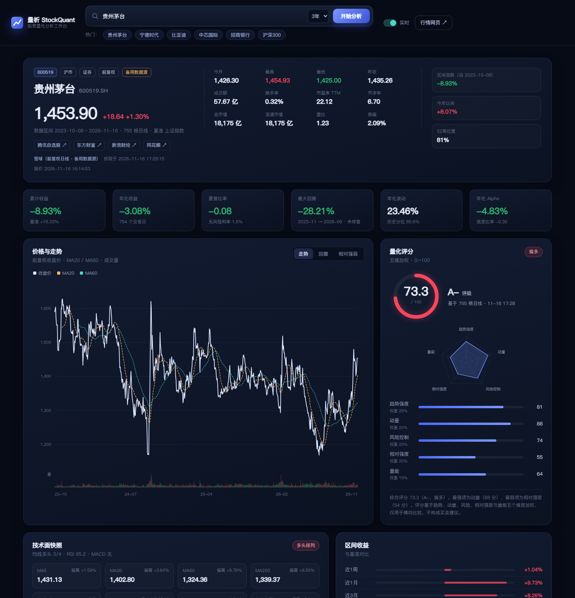

# 量析 StockQuant · 股票量化分析工作台

输入股票名称（或代码），自动联网抓取行情，输出一份完整的量化分析报告。
覆盖 **A 股、美股、黄金 / 原油等商品 ETF**；纯本地运行，无需注册、无需 API Key。



---

## 1. 快速开始

### 桌面窗口版（推荐）

双击桌面上的 **`量析 StockQuant.cmd`**。

它先启动本地数据服务，再用 Edge 的**应用窗口模式**打开界面：没有地址栏和标签页，
任务栏显示「量析 StockQuant」，看起来就是一个独立软件窗口。首次启动约 3 秒，
过程中会闪过一个黑色命令行窗口，属正常现象。

> 关闭窗口后本地服务仍在后台，便于下次秒开；需要彻底退出时在任务管理器结束 `pythonw.exe`。

### 浏览器版

双击 **`启动量析.cmd`**，在默认浏览器中打开 <http://127.0.0.1:8765>。

### 命令行

```bat
cd stock_quant
python server.py --port 8765 --open
```

或指定端口 / 不自动开浏览器：

```bat
powershell -ExecutionPolicy Bypass -File launch.ps1 -Port 8899 -NoBrowser
```

若 8765 被占用，服务会自动尝试 8766–8774，并在控制台打印实际地址。

### 安全说明

- 本机 `127.0.0.1` 访问免口令；局域网访问必须带访问口令（8 位，保存在 `data/access_token.txt`，重启不变）
- 电脑端「手机」二维码已包含口令，未授权设备打开只会看到 401 提示
- 已加安全响应头：CSP、X-Frame-Options、nosniff、Referrer-Policy、Permissions-Policy
- 已禁用目录列表；页面/JS/CSS 禁缓存
- 浏览器提示「不安全」是因为本地服务使用 HTTP，不代表被入侵；局域网内传输仍未加密，请只在可信 Wi-Fi 使用，不要直接映射到公网
- 如需公网访问，请用反向代理（Caddy/Nginx）加 HTTPS 与额外认证
- 重置口令：删除 `data/access_token.txt` 后重启

### 手机 / 平板访问

1. 电脑与手机连接同一个 Wi-Fi
2. 电脑上点页面顶部「手机」，弹出二维码
3. 手机扫码打开，浏览器菜单选择「添加到主屏幕」
4. 之后从桌面图标进入，全屏显示

服务监听 `0.0.0.0:8765`，首次启动如被 Windows 防火墙拦截，请允许 Python 的「专用网络」访问。
手机页面会自动切换为窄屏布局（隐藏成交额、压缩工具栏）。

> 说明：当前为移动网页版（可添加到主屏幕）。生成原生 Android APK 需要 Android SDK / Java，
> 本机未安装，因此未打包 APK。

### 环境要求

| 依赖 | 版本 | 说明 |
|---|---|---|
| Python | 3.10+ | 代码使用 `X | None` 类型标注 |
| pandas | 2.x / 3.x | 行情整理与统计 |
| numpy | 1.24+ | 数值计算 |

```bat
pip install pandas numpy
```

> 若本机没有独立 Python，启动脚本会自动使用 DSH 自带的 Python 运行时。

---

## 2. 功能

### 黄金数据

- **黄金连续**：日线用新浪 `AU0` 连续合约（2008-01 至今），报价用 `nf_AU0` 实时
- **纽约黄金**：日线用 COMEX `GC`（2016-11 至今），报价用 `hf_GC` 实时
- 主页黄金卡片直接进入对应合约的完整量化分析，不再用 518880 / GLD 代理
- 黄金没有成交额、市值等股票字段，页面显示「—」属正常

### 首页市场概览

欢迎页顶部展示 8 个指数/商品与两市涨跌家数：

- 上证指数、深证成指、创业板指
- 标普 500、纳斯达克、道琼斯
- 黄金连续（新浪 AU0 连续合约，2008 年至今）、纽约黄金（COMEX GC，2016 年至今）
- A 股涨 / 平 / 跌家数（全市场约 5600 只，新浪分页统计）
- 美股涨 / 平 / 跌家数（纳斯达克全市场约 6900 只，非样本）
- 点击任意指数卡片可直接进入该指数的量化分析（黄金连续用 AU0 连续合约，纽约黄金用 COMEX GC）

每 60 秒自动刷新，数据源与详情页一致（腾讯 / 新浪 / 东方财富）。

### 输入与联想

- 支持**中文名称**、**拼音首字母**、**6 位代码**：`贵州茅台`、`gzmt`、`600519`、`sh600519`
- 输入时实时联想（名称 / 代码 / 市场 / 类型），支持 ↑↓ 选择、回车确认
- 热门股票快捷入口；分析结果写入 URL（`#q=sh600519`），可收藏/分享
- 分析区间可切换 **1 / 3 / 5 / 10 / 20 年 / 全部（约 30 年）**

### 支持范围

| 市场 | 示例 | 说明 |
|---|---|---|
| A 股 | `贵州茅台`、`600519`、`gzmt` | 沪深京 A 股、ETF、指数 |
| 美股 | `苹果`、`AAPL`、`NVDA`、`TSLA` | 纳斯达克 / 纽交所个股与 ETF |
| 黄金 / 原油 | `黄金`、`原油`、`GLD`、`USO` | 以美股商品 ETF 为标的（美元计价） |

常用别名：苹果→AAPL、英伟达→NVDA、特斯拉→TSLA、黄金→GLD、原油→USO、
白银→SLV、标普500→SPY。

> 美股与商品 ETF 的日线来自雪球（前复权），实时报价来自腾讯，基准为标普 500；
> 商品类以 GLD / USO 等 ETF 跟踪金价与油价，走势与现货高度相关但并非期货价格。

### 涨跌幅榜

顶部「涨跌榜」按钮打开当日排行，点击任意一行可直接分析该标的：

| 榜单 | 范围 | 展示 |
|---|---|---|
| A 股 | 沪深全市场约 5500 只 | 涨幅 / 跌幅各前 50 |
| 美股 | 约 130 只主要美股与 ETF | 涨幅 / 跌幅各前 50 |
| 黄金 | 黄金概念股 + 黄金 ETF（约 30 只） | 上涨 / 下跌各前 10 |

榜单每 60 秒缓存一次，可手动刷新；A 股与黄金数据来自新浪，美股来自腾讯批量快照。

### 模型与公式

顶部「模型」页公开全部计算口径，按收益风险、相对基准、技术指标、五维评分、均线回测、
隔日预测、蒙特卡洛、波动率与仓位八组列出公式与参数。

分析页新增 6 个进阶指标：

- **Omega**：阈值以上收益 / 阈值以下损失
- **溃疡指数（Ulcer）**：回撤平方均值的平方根
- **Treynor**：(CAGR − r_f) / β
- **M²**：r_f + Sharpe × σ_基准
- **Kelly 仓位**：(CAGR − r_f) / σ²，仅作参考
- **GARCH(1,1) 次日波动**：参数用网格近似极大似然估计

> 没有单一“最优秀”的量化模型，不同市场状态与持有期适用不同方法；本软件把公式全部公开，
> 便于复盘与二次开发。

### 组合优化

「研究 → 组合优化」：评分板前 20 只股票，500 根日线，Ledoit-Wolf 协方差收缩，仅做多并限制单票上限。

- 方法：最大夏普、最小方差、风险平价、最大分散
- 输出：预期年化、波动、夏普、分散化比率、有效持仓数、权重与风险贡献
- 约束：权重和为 1、单票 ≤20/25/30%
- 局限：预期收益用历史均值向中位数收缩，估计误差大；暂未做行业中性约束；不含交易成本

### 因子研究

顶部「研究」：在评分板前 40 只股票上做横截面因子检验（雪球 500 根日线，月度调仓）。

- 因子：20/60 日动量、5 日反转、低波动、流动性
- 输出：IC / RankIC 均值、ICIR、IC>0 占比、样本内/样本外 IC、五分层年化、多空组合（扣 12bp 成本）、换手率
- 样本内/外按前 60% / 后 40% 调仓期切分
- 局限：股票池按当前存续取，有幸存者偏差；未做行业中性化；无 point-in-time 数据

### 资金模拟

顶部「模拟」分 A 股 / 美股，输入金额、持有天数与风险偏好（保守/稳健/激进）：

- **资金档位与心态**：小资金建议 1–2 只、留 10%+ 现金；中等 3–4 只；大资金 5–6 只、单票 ≤22%
- **交易规则**：A 股 T+1、100 股/手、涨跌停、印花税 0.05%；美股 T+0、1 股起、无涨跌停、佣金多为 0
- **买入建议**：按评分、波动、可买性选股，按整手/整股计算股数与剩余现金，并二次分配零钱
- **路径模拟**：历史日收益自助抽样 3000 条，输出期末中位数、5%–95% 区间、盈利概率、最大回撤中位数
- 金额与天数由用户输入；结果仅用于研究，不构成投资建议

### 量化评分板

顶部「评分板」分 A 股 / 美股两部分，各展示五维评分前 100：

- A 股候选：成交额前 200，剔除 ST、退市与 2 元以下
- 美股候选：纳斯达克市值前 200，剔除 ETF
- 评分直接复用分析页的趋势/动量/风险/相对强度/量能模型
- 日线取雪球最近 260 根，后台 6 线程并发计算，结果缓存 10 分钟
- 首次打开约 10–20 秒，页面显示「计算中 x/200」进度
- 美股名称自动转为中文（腾讯批量快照），无中文名时保留英文
- 列表新增「年化」列：近一年年化收益率
- 点击任意一只先弹出「预测依据」：收盘位置、超跌/涨幅透支、换手三项得分与权重，加权公式与形态理由，再可进入完整分析

### 隔日预测

顶部「预测」给出下一交易日的方向清单，A 股 / 美股各 10 只看涨、10 只看跌：

- 打分：形态 40% + 资金 20% + 消息 15% + 行为 15% + 情绪 10%
- 资金：A 股主力净流入占比（东方财富批量）；美股无公开主力口径，取中性 50
- 消息：东方财富 / 纳斯达克新闻标题情绪，并计算与股价反应的预期差
- 行为：换手率（美股用成交额分位）、振幅、收盘位置
- 情绪：指数当日涨跌幅映射
- 样本：A 股涨跌幅前 100，美股主要股票池；剔除涨跌停、ST 与低流动性标的
- 每只给出 **预计涨跌幅**（如 +3.9% / -4.4%，附 ± 区间）、0–100 预测分与一句形态理由
- 预计幅度由预测分与当日振幅估算，点击可直接进入完整量化分析
- 规则化量价形态信号，**不是机器学习预测**，不构成投资建议
### 预测复盘

- 每次生成预测自动存档到 `data/predictions/`，按日期与市场保存
- 下一交易日收盘后打开「预测 → 复盘」，自动取次日收盘价逐只对比
- 展示方向命中率、平均实际涨跌、平均绝对误差，以及每只的预测、实际、偏差
- 仅统计打过分的方向：预测涨且实际涨、预测跌且实际跌记为命中


### 自动联网

每次分析自动完成：

1. 证券解析（名称 → 代码 → 市场）
2. 抓取日线（优先前复权），按 640 根/次自动向前分页
3. 抓取对应基准指数（沪市→上证指数、深市→深证成指、创业板→创业板指、科创板→科创50）
4. 抓取实时快照，若当日 K 线尚未生成则自动补一根
5. 计算全部指标并返回前端渲染

数据源按顺序自动降级：**腾讯财经 → 雪球 → 新浪财经**。
当前使用的数据源会显示在页面顶部；使用备用源时会出现「备用数据源」标记。

### 分析内容

| 模块 | 内容 |
|---|---|
| 概览 | 最新价、涨跌幅、成交额、换手率、PE、PB、市值、量比、振幅 |
| 区间收益 | 近 1 周 / 1 月 / 3 月 / 6 月 / 1 年 / 3 年 / 今年以来 / 全区间 |
| 风险收益 | 累计与年化收益、年化波动、夏普、索提诺、卡玛、最大回撤（起止与修复）、当前回撤、日胜率、偏度、峰度、VaR/CVaR、最好/最差单日 |
| 相对基准 | Beta、年化 Alpha、相关系数、跟踪误差、信息比率、相对强弱曲线 |
| 技术面 | MA5/20/60/250 及偏离、均线多头排列、RSI14、MACD、KDJ、布林位置与带宽、ATR、量比、20 日年化波动及历史分位、52 周区间位置 |
| 关键价位 | 均线 / 布林轨道 / 前高前低 / 52 周高低点，合并后给出 3 个支撑与 3 个阻力 |
| 量化评分 | 趋势 25% + 动量 20% + 风险 20% + 相对强度 20% + 量能 15%，0–100 分，A+~D 评级 |
| 策略回测 | MA20/MA60 双均线趋势跟踪（含 12bp 单边成本），对比买入持有 |
| 参数寻优 | 6×6 均线参数网格，按夏普排序展示前 5 组 |
| 概率模拟 | 近 504 日收益自助抽样 3000 条路径，模拟未来 60 日价格分布 |
| 月度收益 | 红涨绿跌热力图 + 年度收益 + 正收益月份占比 |

### 评分逻辑

每个维度由若干规则加权得到 0–100 分，再按权重汇总：

- **趋势**：价格相对 MA20 偏离、MA20 斜率、均线多头排列、长期均线位置
- **动量**：20 日 / 60 日相对基准超额、RSI 区间
- **风险**：年化波动、最大回撤、当前回撤（越低越好）
- **相对强度**：年化 Alpha、信息比率、60 日相对强弱斜率
- **量能**：5/60 日均量比、20 日成交额趋势、流动性

评级：≥85 A+，≥78 A，≥72 A-，≥66 B+，≥60 B，≥54 B-，≥48 C+，≥40 C，其余 D。
信号：≥75 强势、≥62 偏多、≥48 中性、≥35 偏空、其余 弱势。

### 导出

- **导出指标 CSV**：评分、绩效、相对基准、技术面、回测与模拟关键指标
- **打印 / 存为 PDF**：浏览器打印，页面已做打印样式适配

---

## 3. 数据来源

| 用途 | 接口 | 说明 |
|---|---|---|
| 名称联想 | `smartbox.gtimg.cn` | 腾讯证券搜索 |
| 实时快照 | `qt.gtimg.cn` | 最新价 / 量 / 额 / PE / PB / 市值 |
| 日线（主） | `ifzq.gtimg.cn` 等 3 个腾讯主机 | 前复权，自动分页与主机切换 |
| 日线（备） | `stock.xueqiu.com` | 前复权，需首页 Cookie |
| 日线（备） | `quotes.sina.cn` | 不复权，覆盖约 1023 根 |
| 美股日线 | `stock.xueqiu.com` | 前复权，约 1024 根 |
| 美股快照 | `qt.gtimg.cn`（`us` 前缀） | 美元计价 |
| 涨跌榜（A股/黄金） | `vip.stock.finance.sina.com.cn` | 全市场 / 概念板块排名 |
| 涨跌榜（美股） | `qt.gtimg.cn` 批量 | 主要美股池快照 |

- 长周期（超过 6 年）自动走雪球，单页 3000 根向前翻页：A 股可回溯至上市，美股可回溯至 1997 年
- 日线缓存 15 分钟，分析结果缓存 5 分钟，实时报价缓存 4 秒
- 单域名被限流时会自动切换主机，并进入 5 分钟冷却
- 分页单次 640 根，因此 5 年区间也能完整覆盖

> 公开接口可能调整或限流，若全部数据源失败，页面会给出明确错误提示。

---

## 4. 目录结构

```
stock_quant/
├─ server.py            # 本地 HTTP 服务 + JSON API
├─ market.py            # 行情抓取、搜索、代码解析、缓存与降级
├─ analysis.py          # 指标、评分、回测、蒙特卡洛
├─ web/
│  ├─ index.html
│  ├─ style.css
│  └─ app.js            # 原生 JS + 手写 SVG 图表
├─ assets/
│  └─ app.ico           # 程序图标
├─ start_window.cmd     # 桌面窗口版启动脚本
├─ launch.ps1           # 源码方式启动
├─ 启动量析.cmd          # 浏览器版双击入口
└─ README.md
```

### API

| 路径 | 参数 | 返回 |
|---|---|---|
| `GET /api/search` | `q` | 证券联想列表 |
| `GET /api/analyze` | `q`, `years`, `fast`, `slow` | 完整分析 JSON |
| `GET /api/refresh` | 同上 | 强制刷新（跳过缓存） |
| `GET /api/quote` | `q` | 实时快照 |
| `GET /api/health` | – | 健康检查 |
| `GET /download/app` | – | 下载源码打包（存在时） |

---

## 5. 常见问题

**双击桌面图标没有反应**
确认桌面上的 `量析 StockQuant.cmd` 仍在；脚本会调用本机 Edge 打开独立窗口。
可直接运行 `stock_quant\启动量析.cmd` 用浏览器方式兜底。

**黑窗口一闪而过**
正常，脚本启动服务后会立刻关闭命令行，随后出现应用窗口。

**页面白屏 / 打不开**
先访问 <http://127.0.0.1:8765/api/health>，返回 `{"ok": true}` 表示服务正常；
否则重新双击启动脚本。页面顶部出现红色提示条时，按其说明重启程序。

**提示「行情获取失败」**
通常是网络或接口限流。稍等几分钟重试；程序已内置雪球、新浪两个备用源。

**显示「备用数据源」**
说明腾讯日线接口暂时不可用，已自动切换。若为新浪源，数据为**不复权**，
分红除权日附近收益会有偏差，页面顶部会标注。

**评分与回测能直接用来买卖吗？**
不能。评分是规则化的相对强弱描述，回测是历史统计，均不构成投资建议。

---

## 6. 免责声明

本工具仅用于学习与研究。所有行情来自公开接口，可能存在延迟、缺失或调整；
所有指标、评分、回测与模拟结果均不构成投资建议，据此操作风险自负。
